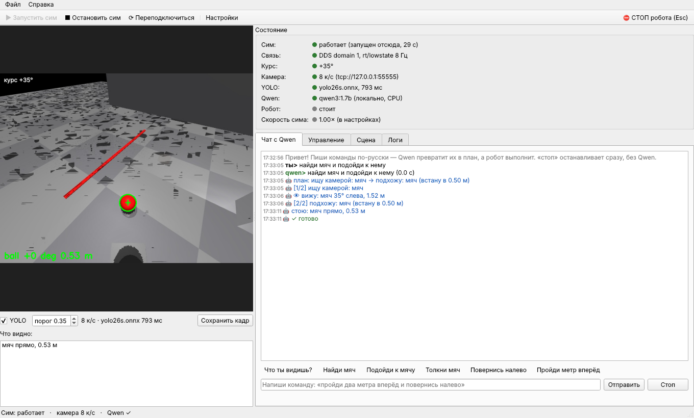
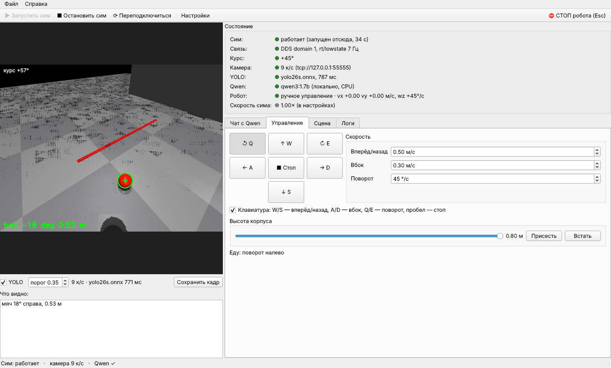

# G1 Studio

Пульт для робота **Unitree G1** в симуляторе **Isaac Sim** ([unitree_sim_isaaclab](https://github.com/unitreerobotics/unitree_sim_isaaclab)).
Одно окно, в котором есть всё:

- **камера робота** с разметкой: красный мяч и предметы, которые находит YOLO26. Для каждого видно направление и расстояние;
- **чат с Qwen**: пишешь «найди мяч и подойди к нему», робот выполняет и отчитывается по шагам;
- **ручное управление**: кнопки и клавиши WASD/QE (русская раскладка тоже работает), высота корпуса, аварийный стоп на Esc;
- **запуск сима кнопкой** или подключение к симу, который уже запущен в терминале;
- **сцена**: добавить мяч, найти и расставить предметы для YOLO;
- **состояние, логи и настройки** в одном файле.


<sub>На скриншоте вместо Isaac Sim работает встроенный MuJoCo-стенд: команда «найди мяч и подойди к нему», робот встал в 0.53 м от мяча.</sub>

---

## Установка

Нужно: Ubuntu 22.04 или 24.04, видеокарта NVIDIA (проверено на RTX 4060 Laptop 8 ГБ), conda.

```bash
git clone git@github.com:FastR1se/g1-studio.git && cd g1-studio

# 1. Isaac Sim + unitree_sim_isaaclab в окружение conda «unitree_sim» (~40 ГБ, 30–60 мин)
bash scripts/install_unitree_sim.sh

# 2. Сама G1 Studio — в отдельное окружение «g1studio», чтобы не трогать пины Isaac Sim
bash scripts/setup_studio.sh            # --bench: ещё MuJoCo-стенд для проверки без Isaac

# 3. Qwen локально (на CPU: видеопамять остаётся Isaac Sim)
curl -fsSL https://ollama.com/install.sh | sh
ollama pull qwen3:1.7b

# 4. Проверить, что всё на месте
g1-studio doctor
```

> Драйвер NVIDIA **590+ роняет Isaac Sim 5.1** (`librtx.scenedb`). Если `doctor` об этом пишет, запусти `bash scripts/switch_nvidia_580.sh`.
> Если что-то сломалось при установке сима: `bash scripts/clean_unitree_install.sh`, потом заново шаг 1.

## Запуск

```bash
g1-studio          # или «G1 Studio» в меню приложений
```

Дальше нажми **▶ Запустить сим** (Isaac Sim грузится 1–3 минуты, ход виден во вкладке «Логи»). Можно и по-старому: запустить `sim_main.py` в терминале, G1 Studio подхватит его сама.

Без Isaac Sim:

```bash
g1-studio --dry    # интерфейс и планы Qwen, в сим ничего не отправляется
```

Или с MuJoCo-стендом: в **Настройки → Симулятор → Что запускать** поставь `bench` и нажми ▶. Это лёгкий сим с той же камерой, тем же DDS и мячом, который можно толкать. Удобно проверять интерфейс за секунды.

## Что умеет робот

| Скажи в чат | Что будет |
|---|---|
| пройди два метра вперёд | ходьба (расстояние по времени × скорость, с поправкой на скорость сима) |
| повернись налево / развернись | поворот по IMU, точность ±3° |
| присядь / встань | высота корпуса 0.3–0.8 м |
| пройди квадрат со стороной метр | план из 8 шагов |
| что ты видишь? / где кружка? | отчёт с камеры |
| найди мяч / найди стул | поворот на месте, пока цель не окажется в кадре |
| подойди к мячу / к человеку | наведение по камере, остановка в 0.5 м (от предметов 0.7 м) |
| толкни мяч посильнее | подход и толчок на 1 м |
| **стоп** | мгновенная остановка, без Qwen |

Предметы распознаёт YOLO26 (80 классов COCO), мяч ищется по цвету. Всё, что предложит Qwen, проверяется и обрезается по безопасным пределам: не больше 5 м за шаг, 1 м/с вперёд, 90°/с поворот, 12 шагов в плане.

## Ручное управление



| Клавиша | Действие |
|---|---|
| W / S (Ц / Ы) | вперёд / назад |
| A / D (Ф / В) | шаг влево / вправо |
| Q / E (Й / У) | поворот налево / направо |
| пробел | стоп |
| **Esc** | аварийный стоп: всё прервать, скорость в ноль |

Робот едет, пока клавиша зажата. Клавиши не работают, когда курсор стоит в поле ввода, а при переключении в другое окно все «зажатые» клавиши отпускаются.

## Сцена: мяч и предметы

Вкладка **«Сцена»** (или `g1-studio scene ...`):

1. **Добавить мяч**: красный мяч ∅ 20 см слева впереди от робота. Позицию можно поменять там же.
2. **Найти предметы в библиотеке Isaac**: скрипт ищет в облачной библиотеке NVIDIA модели человека, стула, бутылки, кружки и т. п. Он сам их меряет (исправляет модели «лёжа» и в сантиметрах) и расставляет вокруг робота. Занимает 2–10 минут, нужен интернет. Результат пишется в `scene_objects.json`.
3. **Подключить предметы** и перезапустить сим.

Сцена правится один раз: в файл задачи вставляется помеченный блок, а при запуске он читает переменные `G1_BALL`, `G1_BALL_POS` и `G1_OBJECTS`. Поэтому галочки «показывать при запуске» работают без повторной правки. Перед первой правкой файл копируется в `*.bak`.

## Настройки

Всё лежит в одном файле `~/.config/g1-studio/config.toml`. Его можно править руками (у каждого поля есть комментарий) или через **Настройки** в окне. Пример со всеми полями: [`config.example.toml`](config.example.toml).

Самое нужное:

- `qwen.model`: `qwen3:1.7b` быстрее, `qwen3:4b` умнее;
- `qwen.backend = "api"` + `qwen.url`: любой OpenAI-совместимый сервер, например DashScope. Ключ лучше передавать переменной `QWEN_API_KEY`;
- `sim.device`: `cpu` (стабильнее ходьба) или `cuda`;
- `sim.headless = true`: без окна Isaac Sim, экономит видеопамять;
- `robot.sim_speed`: если сим идёт медленнее реального времени, шаги «на N метров» получаются короче. Приложение само это заметит и предложит значение в «Состоянии».

## Команды

```
g1-studio                  окно
g1-studio --dry            окно без сима
g1-studio chat             чат с Qwen в терминале
g1-studio vision --save d/ размеченные кадры с камеры в папку
g1-studio scene status     что сейчас в сцене
g1-studio scene ball on    добавить мяч (off — убрать)
g1-studio scene objects on подключить предметы
g1-studio scene find       найти предметы в библиотеке Isaac
g1-studio sim              запустить сим в этом терминале (--print: показать команду)
g1-studio bench            MuJoCo-стенд
g1-studio doctor           проверить установку
g1-studio config --show    файл настроек
```

## Как устроено

```
┌──────────────── G1 Studio (env g1studio) ────────────────┐       ┌──── sim_main.py (env unitree_sim) ────┐
│  окно PySide6: камера · чат · управление · сцена · логи  │       │  Isaac Sim 5.1 + Isaac Lab 2.3        │
│                     │                                    │       │                                       │
│  Studio ─ Qwen (Ollama/API) ─ план ─ Controller 100 Гц ──┼─ DDS ─▶ rt/run_command/cmd  "[vx,vy,wz,h]"  │
│     │                                   ▲ курс (IMU)  ◀──┼─ DDS ── rt/lowstate                         │
│     └─ CameraStream ─ мяч (цвет) + YOLO26 (onnxruntime) ◀┼─ ZMQ ── головная камера JPEG :55555        │
│                                                          │       │                                       │
│  ManagedProcess ── conda run -n unitree_sim python sim_main.py ─▶ (запуск/остановка группой процессов)  │
└──────────────────────────────────────────────────────────┘       └───────────────────────────────────────┘
```

- **Два окружения**. У Isaac Sim жёсткие пины (numpy 1.26, torch 2.7, Python 3.11), а Qt, свежий opencv и onnxruntime их ломают. Поэтому приложение стоит отдельно, а сим запускается в своём env через `conda run`.
- **Команды как у Unitree**. Тот же топик и формат, что у `send_commands_keyboard.py`. Сим сбрасывает команду после каждого шага, поэтому она шлётся 100 раз в секунду с плавным разгоном и торможением. Если приложение упадёт, робот просто встанет.
- **YOLO на CPU** через onnxruntime: видеокарта целиком остаётся Isaac Sim. Расстояние до предмета считается по точке, где он стоит на полу: камера G1 смотрит вниз на 47.6°, поэтому низ предмета виден почти всегда.

```
src/g1_studio/
  core/      planner (Qwen и проверка плана) · controller (исполнитель, ручное) · link (DDS) · studio (всё вместе)
  vision/    geometry (камера G1) · detect (мяч, YOLO) · stream (кадры по ZMQ)
  sim/       process (запуск сима) · scene (мяч и предметы)
  gui/       окно и панели
  isaac/     скрипт, который запускается внутри Isaac Sim (поиск предметов)
  bench.py   MuJoCo-стенд
scripts/     установка сима, приложения, смена драйвера NVIDIA, очистка
models/      yolo26s.onnx (точнее), yolo26n.onnx (вдвое быстрее)
```

## Разработка

```bash
pytest                 # 65 тестов, ~30 с: планы, конфиг, геометрия, мяч, YOLO, исполнитель, процессы, окно
pytest -m bench        # интеграция на MuJoCo-стенде: настоящий DDS и камера, поворот и подход к мячу
ruff check src tests
```

Тесты окна работают и без экрана (`QT_QPA_PLATFORM=offscreen`).

## Если что-то не так

| Симптом | Что делать |
|---|---|
| Окно не открывается: `could not load the Qt platform plugin "xcb"` | `sudo apt install libxcb-cursor0` |
| «Ollama не отвечает» | `ollama serve` или `sudo systemctl start ollama` |
| «модели нет в Ollama» | `ollama pull qwen3:1.7b` |
| Камера: «жду кадры» | сим должен быть запущен с `--enable_cameras` (кнопка ▶ так и делает) |
| Робот проходит меньше, чем сказано | поставь «Скорость сима», которую предлагает «Состояние» |
| Isaac Sim падает в `librtx.scenedb` | `bash scripts/switch_nvidia_580.sh` |
| Сим упал | окно покажет последние строки, полный вывод: «Логи» → «Сим» и `~/.local/state/g1-studio/logs/sim.log` |

## Лицензия

AGPL-3.0, так же, как у моделей YOLO26 от Ultralytics, которые лежат в `models/`. Isaac Sim, Isaac Lab и unitree_sim_isaaclab ставятся отдельно и идут под своими лицензиями.
